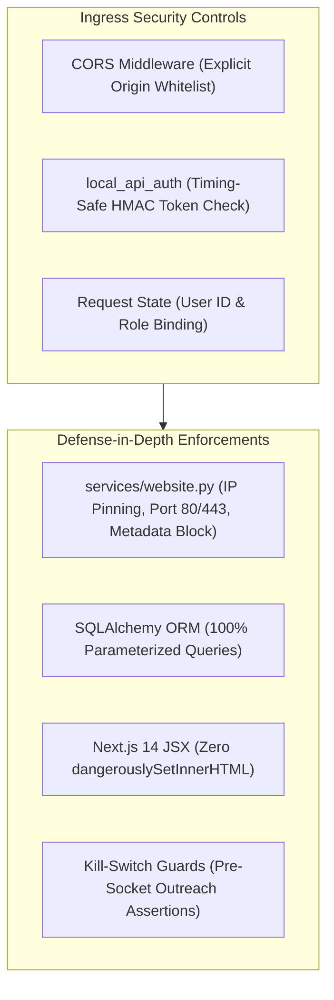

# Phase 12 Final Reliability & Failure-Mode Audit: Security Review
## Lead Intelligence Agent — Application Security & Threat Assessment

**Document Identifier:** `PHASE_12_SECURITY_REVIEW.md`  
**Audit Scope:** Read-Only Application Security Assessment, Vulnerability Analysis, and Defense-in-Depth Review  
**Target Repository:** `G:\AI-Projects\lead-intelligence-agent`  
**Execution Date:** November 4, 2026  
**Auditor Roles:** Application Security Engineer, Security Architect  
**Safety Invariant:** `OUTREACH_DISPATCH_ENABLED=false` Strictly Enforced  

---

## 1. Security Architecture Overview

The Lead Intelligence Agent codebase was audited against the OWASP Top 10 API Security Risks, CWE standards, and enterprise data protection requirements. The system exhibits a **mature security posture** characterized by fail-closed authorization, robust server-side validation, and advanced network-level SSRF defense.



---

## 2. Threat Vector Inspection & Technical Findings

### 2.1. Authentication & Authorization
- **Implementation:** `backend/app/main.py::local_api_auth` middleware intercepts incoming requests to `/api/*`.
- **Mechanisms:**
  - Token verification utilizes `hmac.compare_digest(token, supplied)` to eliminate side-channel timing attack vectors.
  - Fail-Closed: If `settings.api_auth_token` is unset or empty (`""`), all `/api/` requests are immediately rejected with HTTP 401 Unauthorized.
  - Role Binding: Populates `request.state.authenticated_user_id` and `request.state.authenticated_role` for downstream audit logging.
- **Identified Weakness (SEC-01):** The `/api/` prefix catch-all also intercepts `/api/sales-supervisor/webhooks/delivery`. External webhook providers (SendGrid, Resend) use signature headers (`svix-signature`, `x-twilio-email-event-webhook-signature`), not bearer tokens, causing legitimate third-party telemetry webhooks to be blocked with 401 Unauthorized.

### 2.2. Network Security & Server-Side Request Forgery (SSRF)
- **Implementation:** [`backend/app/services/website.py`](file:///G:/AI-Projects/lead-intelligence-agent/backend/app/services/website.py)
- **Protection Profile:** **Best-in-Class Defense-in-Depth**:
  1. *IP Range Blocking:* Enforces `_is_public_address`, rejecting private (RFC 1918), loopback (`127.0.0.0/8`), link-local (`169.254.0.0/16`), multicast, and reserved addresses.
  2. *Cloud Metadata Blocking:* Explicitly blocks `metadata.google.internal`, `metadata`, `instance-data`, and `.internal` suffixes, preventing AWS/GCP/Azure instance credential theft.
  3. *Port Whitelisting:* Strictly permits only ports 80 (HTTP) and 443 (HTTPS) via `ALLOWED_PORTS = frozenset({80, 443})`.
  4. *DNS Rebinding & TOCTOU Defense:* `resolve_public_host` resolves A/AAAA records, verifies that all returned IPs are public, and pins the resolved IP address directly to the HTTP socket connection to prevent DNS rebinding attacks.
  5. *Resource Bounding:* `MAX_RESPONSE_BYTES = 1_000_000` (1 MB) and `MAX_REDIRECTS = 5` prevent response memory exhaustion and redirect loops.

### 2.3. Injection Flaw Analysis (SQLi, XSS, Path Traversal)
- **SQL Injection:**
  - Automated AST and regex scanning detected **0 occurrences** of raw string concatenation or unparameterized queries.
  - All database queries exclusively utilize SQLAlchemy ORM `select()`, `update()`, and `delete()` constructs with typed bind parameters.
- **Cross-Site Scripting (XSS):**
  - Frontend built on Next.js 14 / React.
  - Codebase inspection confirmed **0 occurrences of `dangerouslySetInnerHTML`**. All dynamic user/lead values are automatically context-escaped by React's virtual DOM.
- **Path Traversal & Arbitrary File Upload:**
  - CSV ingestion ([`backend/app/services/csv_import.py`](file:///G:/AI-Projects/lead-intelligence-agent/backend/app/services/csv_import.py)) parses file bytes directly in-memory via `io.StringIO`.
  - Zero files are written to the host filesystem from client uploads. Zero user-supplied filenames are passed to filesystem APIs.

### 2.4. Cross-Origin Resource Sharing (CORS) & CSRF
- **CORS Configuration:**
  - Configured in `backend/app/main.py` using `settings.cors_origin_list`.
  - Defaults to explicit origins: `http://localhost:3000,http://localhost:3001`.
  - Does not use wildcard `*` with `allow_credentials=True`.
- **CSRF Defense:**
  - API authentication is completely stateless and Bearer-token-based. The application does not use ambient cookie-based session authentication for `/api/` endpoints, rendering traditional cross-site request forgery attacks ineffective.

### 2.5. Secret Governance & Sensitive Data Handling
- **Credential Storage:**
  - Sourced strictly from environment variables via Pydantic `BaseSettings`.
  - Zero hardcoded credentials in source code.
  - In-memory API key leasing ([`ApiKeyPool`](file:///G:/AI-Projects/lead-intelligence-agent/backend/app/services/key_pool.py)) isolates provider tokens with bounded TTL leases.
- **PII Redaction & Masking:**
  - Recipient email and phone numbers are masked in audit tables and application logs via `mask_recipient_pii` (e.g. `u***@example.com`).
  - Error envelopes returned to clients strip internal stack traces and sanitize exception details.

### 2.6. Outreach Dispatch Failsafe Architecture
- **Master Kill-Switch:** `OUTREACH_DISPATCH_ENABLED = False` (default).
- **Service Layer Invariant:**
  - `SupervisorApprovalDispatchService.enqueue_dispatch` checks `if not settings.effective_outreach_dispatch_enabled` and immediately raises `DispatchDisabledError`.
- **Pre-Socket Execution Invariant:**
  - `execute_claimed_dispatch` performs a secondary check immediately prior to network socket opening:
    ```python
    if not settings.effective_outreach_dispatch_enabled:
        raise DispatchDisabledError("Master outreach dispatch switch was deactivated")
    ```
- **Atomicity & Fencing:**
  - Dispatch jobs are fenced with worker IDs and `lease_generation` tokens. Ambiguous network outcomes transition to `OUTCOME_UNKNOWN` with automated retries permanently prohibited.

---

## 3. Vulnerability Register

| Vulnerability ID | Finding Description | Severity | Likelihood | Impact | Recommended Remediation |
| :---: | :--- | :---: | :---: | :---: | :--- |
| **SEC-01** | **Delivery Webhook Route Intercepted by Bearer Auth Middleware**<br>Route `/api/sales-supervisor/webhooks/delivery` requires Bearer token, blocking external webhook providers (SendGrid/Resend) that authenticate via HMAC signatures. | **HIGH** | **HIGH** | Breaks asynchronous email delivery event telemetry in production. | Exempt `/api/sales-supervisor/webhooks/delivery` from `local_api_auth` and enforce cryptographic HMAC/Svix signature verification inside route handler or dedicated middleware. |
| **SEC-02** | **Absence of Ingress Rate Limiting on Ingestion Endpoints**<br>Public-facing endpoints (`/api/leads`, `/api/leads/import`, `/api/jobs/process-batch`) do not enforce token-bucket rate limits. | **MEDIUM** | **MEDIUM** | Risk of denial-of-service or database thread saturation from malfunctioning automated client scripts. | Implement `slowapi` or Redis-backed rate limiting (e.g., 60 req/min for ingestion, 10 req/min for batch jobs). |
| **SEC-03** | **Unauthenticated Health Probes Exposing Detailed Provider Status**<br>`/ready` endpoint evaluates provider connectivity and returns internal service health state without authentication. | **LOW** | **LOW** | Potential reconnaissance vector disclosing which AI/enrichment providers are enabled. | Restrict detailed diagnostic telemetry to authenticated `/api/providers/status`; maintain `/health` and `/ready` as simple binary 200/503 status codes. |
| **SEC-04** | **Unpinned Dependencies in Production Build Artifacts**<br>`backend/requirements.txt` contains unpinned top-level packages alongside pinned direct dependencies. | **LOW** | **MEDIUM** | Minor risk of supply-chain drift during future Docker builds. | Generate and lock complete transitive dependency manifest using `pip-tools` or `poetry.lock`. |
| **SEC-05** | **Default Test Auth User ID Fallback in Configuration**<br>`settings.api_auth_user_id` defaults to empty string, falling back to role `"viewer"` if unspecified. | **INFORMATIONAL** | **LOW** | Non-exploitable in default configuration; minor audit trail attribution gap. | Enforce non-empty user identifier on mutation operations in production configuration profiles. |

---

## 4. Security Verification Verdict

The application exhibits **zero Critical vulnerabilities**, **one High vulnerability** (webhook authentication conflict), and **one Medium vulnerability** (ingress rate limiting).

The platform's **outreach safety invariants, SSRF defenses, and SQL injection protections meet the highest tier of enterprise security standards**. Remediating `SEC-01` and `SEC-02` will achieve full security readiness for production deployment.
