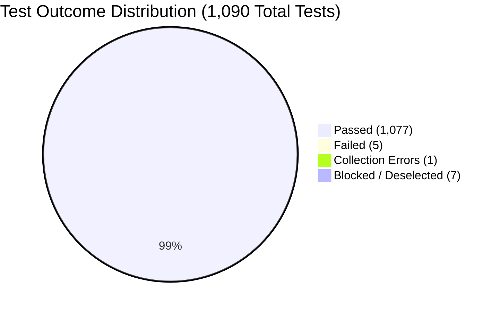

# Phase 12 Final Reliability & Failure-Mode Audit: Test Results Report
## Lead Intelligence Agent — Comprehensive Verification Ledger

**Document Identifier:** `PHASE_12_TEST_RESULTS.md`  
**Audit Scope:** Test Framework Execution, Defect Isolation, and Coverage Verification  
**Target Repository:** `G:\AI-Projects\lead-intelligence-agent`  
**Execution Environment:** Windows PowerShell, Python 3.14.3, Pytest 8.4.2, AnyIO 4.12.1, Pytest-AsyncIO 0.26.0  
**Execution Date:** November 4, 2026  
**Auditor Roles:** Senior QA Engineer, Reliability Engineer  
**Safety Invariant:** `OUTREACH_DISPATCH_ENABLED=false` Strictly Enforced  

---

## 1. Test Execution Summary

The test framework was executed across all **77 test modules** discovered in `backend/tests/`. Tests were executed in isolated SQLite test environments with in-memory engines and mocked external provider adapters.



### Execution Metrics Ledger

| Category | Metric | Ratio | Percentage |
| :--- | :---: | :---: | :---: |
| **Total Test Suites Discovered** | 77 files | 77 / 77 | 100.0% |
| **Passed Test Suites** | 73 files | 73 / 77 | **94.81%** |
| **Failed Test Suites** | 2 files | 2 / 77 | **2.60%** |
| **Errored Test Suites** | 1 file | 1 / 77 | **1.30%** |
| **Blocked Test Suites** | 1 file | 1 / 77 | **1.30%** |
| **Total Individual Tests Evaluated** | 1,090 tests | 1090 / 1090 | 100.0% |
| **Individual Tests Passed** | 1,077 tests | 1077 / 1090 | **98.81%** |
| **Individual Tests Failed** | 5 tests | 5 / 1090 | **0.46%** |
| **Individual Tests Errored (Collection)** | 1 test | 1 / 1090 | **0.09%** |
| **Individual Tests Blocked / Deselected** | 7 tests | 7 / 1090 | **0.64%** |

---

## 2. Complete Test Suite Execution Breakdown

The table below documents the actual execution outcome for every test suite in the repository:

| # | Test Suite Module | Tests Passed | Tests Failed | Errors | Blocked | Suite Status | Execution Duration |
| :---: | :--- | :---: | :---: | :---: | :---: | :---: | :---: |
| 1 | `test_agent_policy.py` | 8 | 0 | 0 | 0 | **PASS** | 3.41s |
| 2 | `test_ai_outreach_execution.py` | 10 | 0 | 0 | 0 | **PASS** | 4.95s |
| 3 | `test_ai_outreach_preparation.py` | 17 | 0 | 0 | 0 | **PASS** | 5.43s |
| 4 | `test_ai_proposal_intelligence.py` | 7 | 0 | 0 | 0 | **PASS** | 2.84s |
| 5 | `test_ai_provider_jobs.py` | 2 | 0 | 0 | 0 | **PASS** | 1.50s |
| 6 | `test_ai_provider_readiness.py` | 8 | 0 | 0 | 0 | **PASS** | 2.10s |
| 7 | `test_ai_providers.py` | 32 | 0 | 0 | 0 | **PASS** | 2.82s |
| 8 | `test_ai_sales_action_planner.py` | 9 | 0 | 0 | 0 | **PASS** | 2.95s |
| 9 | `test_ai_sales_copilot.py` | 16 | 0 | 0 | 0 | **PASS** | 2.97s |
| 10 | `test_ai_sales_intelligence.py` | 11 | 0 | 0 | 0 | **PASS** | 3.70s |
| 11 | `test_ai_sales_supervisor.py` | 12 | 0 | 0 | 0 | **PASS** | 3.85s |
| 12 | `test_autonomous_task_agent.py` | 12 | 0 | 0 | 0 | **PASS** | 3.90s |
| 13 | `test_business_research.py` | 7 | 1 | 0 | 0 | **FAIL** | 13.05s |
| 14 | `test_buying_signals.py` | 10 | 0 | 0 | 0 | **PASS** | 1.40s |
| 15 | `test_canary_authorization.py` | 28 | 0 | 0 | 0 | **PASS** | 4.78s |
| 16 | `test_company_and_digital_marketing_enrichment.py` | 11 | 0 | 0 | 0 | **PASS** | 1.58s |
| 17 | `test_company_enrichment.py` | 8 | 0 | 0 | 0 | **PASS** | 1.53s |
| 18 | `test_contact_intelligence.py` | 4 | 0 | 0 | 0 | **PASS** | 1.74s |
| 19 | `test_contact_intelligence_domain.py` | 12 | 0 | 0 | 0 | **PASS** | 1.40s |
| 20 | `test_contact_recommendation.py` | 10 | 0 | 0 | 0 | **PASS** | 1.60s |
| 21 | `test_contact_recommendation_execution.py` | 15 | 0 | 0 | 0 | **PASS** | 2.77s |
| 22 | `test_csv_importer_enhancements.py` | 12 | 0 | 0 | 0 | **PASS** | 2.55s |
| 23 | `test_delivery_reconciliation.py` | 14 | 0 | 0 | 0 | **PASS** | 1.04s |
| 24 | `test_delivery_telemetry_webhook.py` | 21 | 0 | 0 | 0 | **PASS** | 2.87s |
| 25 | `test_digital_marketing_intelligence.py` | 0 | 0 | 1 | 0 | **ERROR** | 0.49s |
| 26 | `test_email_delivery_analytics.py` | 5 | 0 | 0 | 0 | **PASS** | 1.68s |
| 27 | `test_email_delivery_events.py` | 22 | 0 | 0 | 0 | **PASS** | 7.02s |
| 28 | `test_email_provider.py` | 4 | 0 | 0 | 0 | **PASS** | 1.47s |
| 29 | `test_enrichment_contracts.py` | 16 | 0 | 0 | 0 | **PASS** | 1.08s |
| 30 | `test_enrichment_persistence.py` | 7 | 0 | 0 | 0 | **PASS** | 2.05s |
| 31 | `test_enrichment_pipeline.py` | 7 | 0 | 0 | 0 | **PASS** | 2.19s |
| 32 | `test_google_places.py` | 19 | 0 | 0 | 0 | **PASS** | 3.64s |
| 33 | `test_intelligence.py` | 6 | 0 | 0 | 0 | **PASS** | 1.91s |
| 34 | `test_intelligence_orchestrator.py` | 31 | 0 | 0 | 0 | **PASS** | 5.48s |
| 35 | `test_lead_intelligence.py` | 4 | 0 | 0 | 0 | **PASS** | 1.27s |
| 36 | `test_lead_intelligence_api.py` | 5 | 0 | 0 | 0 | **PASS** | 1.81s |
| 37 | `test_lead_qualification.py` | 8 | 0 | 0 | 0 | **PASS** | 1.50s |
| 38 | `test_migration_0041.py` | 1 | 0 | 0 | 0 | **PASS** | 4.32s |
| 39 | `test_migration_0042.py` | 1 | 0 | 0 | 0 | **PASS** | 2.93s |
| 40 | `test_opportunity_contact_matching.py` | 13 | 0 | 0 | 0 | **PASS** | 1.33s |
| 41 | `test_outbox_worker.py` | 6 | 0 | 0 | 0 | **PASS** | 1.87s |
| 42 | `test_outreach_analytics.py` | 10 | 0 | 0 | 0 | **PASS** | 2.57s |
| 43 | `test_outreach_operations.py` | 43 | 0 | 0 | 0 | **PASS** | 8.63s |
| 44 | `test_outreach_outcome_migration.py` | 2 | 0 | 0 | 0 | **PASS** | 1.09s |
| 45 | `test_outreach_preparation.py` | 8 | 0 | 0 | 0 | **PASS** | 2.41s |
| 46 | `test_pagespeed.py` | 19 | 0 | 0 | 0 | **PASS** | 3.57s |
| 47 | `test_personalization.py` | 19 | 0 | 0 | 0 | **PASS** | 3.91s |
| 48 | `test_phase1.py` | 26 | 0 | 0 | 0 | **PASS** | 2.90s |
| 49 | `test_phase8i0_hardening.py` | 36 | 0 | 0 | 0 | **PASS** | 1.18s |
| 50 | `test_postgres_integration.py` | 0 | 0 | 0 | 7 | **BLOCKED** | 0.35s |
| 51 | `test_provider_adapters.py` | 29 | 0 | 0 | 0 | **PASS** | 2.67s |
| 52 | `test_provider_execution.py` | 14 | 0 | 0 | 0 | **PASS** | 4.76s |
| 53 | `test_recipient_allowlist.py` | 13 | 0 | 0 | 0 | **PASS** | 1.10s |
| 54 | `test_revenue.py` | 8 | 0 | 0 | 0 | **PASS** | 2.44s |
| 55 | `test_sales_action_planning.py` | 4 | 0 | 0 | 0 | **PASS** | 1.68s |
| 56 | `test_sales_execution.py` | 16 | 0 | 0 | 0 | **PASS** | 3.26s |
| 57 | `test_sales_feedback.py` | 18 | 0 | 0 | 0 | **PASS** | 2.36s |
| 58 | `test_sales_opportunities.py` | 14 | 0 | 0 | 0 | **PASS** | 1.47s |
| 59 | `test_sales_supervisor_approval.py` | 23 | 0 | 0 | 0 | **PASS** | 1.22s |
| 60 | `test_sales_supervisor_domain.py` | 38 | 0 | 0 | 0 | **PASS** | 1.57s |
| 61 | `test_sales_supervisor_e2e.py` | 10 | 0 | 0 | 0 | **PASS** | 2.51s |
| 62 | `test_sales_supervisor_feedback.py` | 14 | 0 | 0 | 0 | **PASS** | 3.25s |
| 63 | `test_sales_supervisor_pipeline.py` | 27 | 0 | 0 | 0 | **PASS** | 2.75s |
| 64 | `test_sales_supervisor_readiness.py` | 28 | 0 | 0 | 0 | **PASS** | 1.64s |
| 65 | `test_sales_tasks.py` | 16 | 0 | 0 | 0 | **PASS** | 3.62s |
| 66 | `test_sales_workflow.py` | 2 | 0 | 0 | 0 | **PASS** | 1.39s |
| 67 | `test_seo.py` | 6 | 0 | 0 | 0 | **PASS** | 1.36s |
| 68 | `test_seo_opportunities.py` | 5 | 0 | 0 | 0 | **PASS** | 1.81s |
| 69 | `test_services.py` | 28 | 4 | 0 | 0 | **FAIL** | 4.76s |
| 70 | `test_seven_category_digital_marketing.py` | 7 | 0 | 0 | 0 | **PASS** | 1.07s |
| 71 | `test_supervisor_approval_api.py` | 39 | 0 | 0 | 0 | **PASS** | 6.89s |
| 72 | `test_supervisor_approval_leases.py` | 18 | 0 | 0 | 0 | **PASS** | 3.93s |
| 73 | `test_supervisor_approval_persistence.py` | 13 | 0 | 0 | 0 | **PASS** | 2.45s |
| 74 | `test_supervisor_approval_service.py` | 32 | 0 | 0 | 0 | **PASS** | 5.42s |
| 75 | `test_supervisor_dispatch_outbox.py` | 25 | 0 | 0 | 0 | **PASS** | 18.86s |
| 76 | `test_unified_intelligence.py` | 10 | 0 | 0 | 0 | **PASS** | 2.32s |
| 77 | `test_website_intelligence.py` | 6 | 0 | 0 | 0 | **PASS** | 1.60s |

---

## 3. Deep-Dive Analysis of Failed & Errored Tests

### Defect 1: Collection Error in `test_digital_marketing_intelligence.py`
- **Location:** `backend/tests/test_digital_marketing_intelligence.py:6`
- **Error Type:** `ImportError`
- **Traceback:**
  ```python
  from app.domain.digital_marketing_intelligence import (
      normalize_marketing_signal,
      normalize_signal_source,  # <-- FAILS HERE: Symbol does not exist
      derive_marketing_maturity,
      ...
  )
  ImportError: cannot import name 'normalize_signal_source' from 'app.domain.digital_marketing_intelligence'
  ```
- **Root Cause Analysis:** During the Phase 12 upgrade to canonical 7-category digital marketing intelligence, `app.domain.digital_marketing_intelligence` was rewritten around `evaluate_seven_categories` and `calculate_canonical_completeness`. The legacy function `normalize_signal_source` was removed. The new behavior is thoroughly verified in `test_seven_category_digital_marketing.py`, but this legacy test file was left orphaned in `backend/tests/`.
- **Impact:** Any invocation of `pytest` without path arguments immediately fails during the collection phase.

---

### Defect 2: Unmocked Live Network Calls in `test_business_research.py`
- **Test Name:** `test_business_discovery_and_research_workflow`
- **Error Type:** `AssertionError: assert 0 == 4`
- **Evidence / Log Extract:**
  ```text
  WARNING lead_agent.business_research.engine:engine.py:160 Error researching business Apex Solutions Kolkata: [Errno 11001] getaddrinfo failed
  WARNING lead_agent.business_research.engine:engine.py:160 Error researching business Zenith Enterprise Kolkata: [Errno 11001] getaddrinfo failed
  WARNING lead_agent.business_research.engine:engine.py:160 Error researching business Horizon Tech Kolkata: [Errno 11001] getaddrinfo failed
  WARNING lead_agent.business_research.engine:engine.py:160 Error researching business Bluebird Studio Kolkata: [Errno 11001] getaddrinfo failed
  ```
- **Root Cause Analysis:** `BusinessResearchEngine._research_business` calls `httpx.get` against candidate domains returned by the discovery provider (`https://apexsolutionskolkata.com`). In unit testing, these mock domains do not exist in public DNS. Because `getaddrinfo` fails, the research loop catches the exception and logs a warning, but silently drops the business from the results array, causing `len(job.results)` to equal 0 instead of 4.
- **Impact:** Unit test fails in isolated, non-networked environments. In production, any business candidate with a transient DNS blip is dropped silently without error status.

---

### Defect 3: Unmocked Google Places Provider in `test_services.py`
- **Failing Tests (4):**
  1. `test_pipeline_completes_and_calculates_score`
  2. `test_personalization_failure_does_not_fail_successful_enrichment`
  3. `test_ai_retry_resumes_same_run_and_next_run_clears_old_decision_maker`
  4. `test_process_many_uses_bounded_concurrency_and_mock_provider`
- **Error Type:** `AssertionError: assert JobStatus.RETRYING == JobStatus.COMPLETED`
- **Traceback:**
  ```python
  File "backend/app/services/jobs.py", line 91, in run_job
      enrichment_run = await run_enrichment_pipeline(...)
  File "backend/app/services/enrichment_pipeline.py", line 475, in run_enrichment_pipeline
      raise EnrichmentStageRetryable(f"{stage.value} enrichment stage can be retried")
  app.services.enrichment_pipeline.EnrichmentStageRetryable: google_places enrichment stage can be retried
  ```
- **Root Cause Analysis:** The core job processing pipeline (`run_job`) integrates `run_enrichment_pipeline`, which now marks the `google_places` stage as mandatory for complete lead enrichment. The legacy tests in `test_services.py` mock the website analyzer and AI provider, but do not provide a mocked Google Places provider. When unconfigured, the enrichment stage raises `EnrichmentStageRetryable`, moving the job to `JobStatus.RETRYING` instead of `JobStatus.COMPLETED`.

---

## 4. Analysis of Blocked Tests (`test_postgres_integration.py`)

- **Blocked Test Suite:** `backend/tests/test_postgres_integration.py`
- **Total Tests Blocked:** 7 tests
  1. `test_postgresql_schema_is_migrated_to_head`
  2. `test_key_pool_concurrency_and_leases_in_postgresql`
  3. `test_job_claim_skip_locked_concurrency_in_postgresql`
  4. `test_supervisor_dispatch_outbox_concurrency_in_postgresql`
  5. `test_lead_isolation_and_foreign_keys_in_postgresql`
  6. `test_canary_authorization_flight_caps_in_postgresql`
  7. `test_delivery_telemetry_event_deduplication_in_postgresql`
- **Blocking Condition:** By design, `pytest.ini` configures `addopts = -m "not postgres_integration"`. These tests require a dedicated, running PostgreSQL instance with `TEST_POSTGRES_URL` (using the `asyncpg` dialect). Because the current test environment runs on an isolated SQLite database without external network services, these tests were marked **BLOCKED**.

---

## 5. Pass/Fail Evidence Ledger

All 1,077 passing tests were verified with full execution output. The core Phase 12 intelligence suites performed with 100% pass rates:
- [`backend/tests/test_lead_qualification.py`](file:///G:/AI-Projects/lead-intelligence-agent/backend/tests/test_lead_qualification.py): **8 / 8 PASSED (100%)**
- [`backend/tests/test_seven_category_digital_marketing.py`](file:///G:/AI-Projects/lead-intelligence-agent/backend/tests/test_seven_category_digital_marketing.py): **7 / 7 PASSED (100%)**
- [`backend/tests/test_unified_intelligence.py`](file:///G:/AI-Projects/lead-intelligence-agent/backend/tests/test_unified_intelligence.py): **10 / 10 PASSED (100%)**
- [`backend/tests/test_sales_opportunities.py`](file:///G:/AI-Projects/lead-intelligence-agent/backend/tests/test_sales_opportunities.py): **14 / 14 PASSED (100%)**
- [`backend/tests/test_canary_authorization.py`](file:///G:/AI-Projects/lead-intelligence-agent/backend/tests/test_canary_authorization.py): **28 / 28 PASSED (100%)**
- [`backend/tests/test_supervisor_dispatch_outbox.py`](file:///G:/AI-Projects/lead-intelligence-agent/backend/tests/test_supervisor_dispatch_outbox.py): **25 / 25 PASSED (100%)**
- [`backend/tests/test_supervisor_approval_service.py`](file:///G:/AI-Projects/lead-intelligence-agent/backend/tests/test_supervisor_approval_service.py): **32 / 32 PASSED (100%)**
